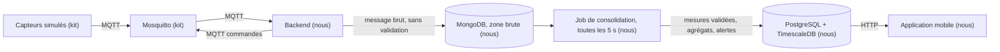

# Architecture



Le consommateur MQTT n'écrit pas dans PostgreSQL : voir `docs/decisions/J2/08-base-brute-mongodb.md`.

## Technologies retenues

| Couche | Techno | Version |
|---|---|---|
| Runtime | Node.js LTS | 24.21.0 |
| Langage | TypeScript | 7.0.2 |
| API | Fastify | 5.12.4 |
| Client MQTT | mqtt | 5.15.2 |
| Base | PostgreSQL | 18.6 |
| Séries temporelles | TimescaleDB | 2.30.0 |
| Zone brute | MongoDB | 8.3.11 |
| Pilote MongoDB | mongodb | 7.6.0 |
| Accès aux données | pg et Kysely | 8.23.0 et 0.29.5 |
| Migrations | node-pg-migrate | 9.0.0 |
| Validation | Zod | 4.6.5 |
| Traces | Pino | 10.3.1 |
| Mobile | Expo SDK 57 (React Native 0.86) | expo 57.0.22 |
| Navigation mobile | Expo Router | 57.0.21 |
| Réseau et cache mobile | TanStack Query | 5.102.8 |
| Persistance du cache mobile | react-query-persist-client, query-async-storage-persister | 5.103.0 |
| Détection du réseau | NetInfo | 12.0.1 |
| Stockage local | AsyncStorage | 2.2.0 |
| Interface | React Native Paper | 5.15.3 |

`@fastify/jwt` et `argon2` sont installées mais jamais appelées. `expo-secure-store` et
`expo-camera` ne sont pas installées. Authentification et scan de QR sont hors livrable
(`docs/J5.md`). Pas d'état global : TanStack Query suffit. Choix : `docs/decisions/J1/`.

## Organisation du code

```
backend/src/
  schemas/    schémas Zod : le format des messages et des requêtes
  domain/     les règles : doublon, ordre des mesures, fraîcheur, tranches d'agrégat, commandes, alertes
  db/         requêtes SQL, accès à la zone brute, migrations
  mqtt/       connexion au broker, abonnements, écriture du brut
  jobs/       le job de consolidation, et le script de rejeu
  http/       routes Fastify
```

Architecture en couches : `http/`, `mqtt/` et `jobs/` appellent `domain/` et `db/`, jamais
l'inverse. `domain/` n'importe ni la base, ni le broker, ni Fastify. Hexagonale, CQRS et
microservices écartés : `docs/decisions/J1/04-architecture-du-backend.md`.

```
mobile/src/
  app/         les routes Expo Router, rien d'autre
  api/         client HTTP, schémas Zod, requêtes
  components/  composants d'affichage réutilisés
  lib/         fonctions sans dépendance, cache, détection du réseau, horloge
```

Seul `app/` connaît les routes, seul `api/` appelle le réseau. Les trois écrans partagent la clé
de cache de `GET /rooms`. Voir `docs/decisions/J1/07-architecture-de-l-application-mobile.md`.

## Identité des objets et topics MQTT

Les objets `sensor-001` à `sensor-003` sont déclarés dans `infra/kit/devices.json`. Le backend
refuse un message si le `device_id` du topic diffère de celui du corps. Le `room_id` du message
n'est qu'une affectation de départ.

Seuls les objets autorisés du registre (table `devices`, colonne `autorise`, posée à
l'enrôlement) écrivent des mesures. Avant J3, un objet inconnu était créé avec sa salle. Voir
`docs/decisions/J3/13-registre-des-objets-autorises.md`.

L'identité suit le message jusqu'aux traces (`deviceId`, `eventId`, `topic`).

| Topic | Sens | Retained | Usage |
|---|---|---|---|
| `campus/v1/devices/{device_id}/telemetry` | objet vers backend | non | Mesures |
| `campus/v1/devices/{device_id}/state` | objet vers backend | oui | Ventilation et `boot_id` |
| `campus/v1/devices/{device_id}/availability` | objet ou broker vers backend | oui | Joignable ou non |
| `campus/v1/devices/{device_id}/commands` | backend vers objet | non | QoS 1, jamais retained, sinon renvoyée à chaque reconnexion |
| `campus/v1/devices/{device_id}/results` | objet vers backend | non | Résultat par `command_id`, traité comme une mesure |

Le backend s'abonne avec `+`, en QoS 1 et session persistante : le broker garde les messages
pendant son absence (mesuré dans `docs/J3.md`, scénario 8).

Le `message_id` commence par le `boot_id` publié sur `state`. Sinon la mesure est acceptée mais
signalée. Le compte MQTT est partagé, donc c'est une détection, pas une protection
(`docs/decisions/J3/10-identite-des-objets-et-usurpation.md`).

## Validation des messages

Le consommateur écrit tout tel quel dans la zone brute, même illisible. Le job valide ensuite.

| Contrôle | Règle | Où |
|---|---|---|
| Message lisible | JSON, sinon texte conservé | `jobs/consolidation.ts` |
| Structure et types | Schéma Zod du kit | `schemas/mqtt.ts` |
| Bornes physiques | -40 à 85 °C, 0 à 40000 ppm | `schemas/mqtt.ts` |
| Date d'observation | Au plus 10 s dans l'avenir | `domain/fraicheur.ts` |
| Cohérence d'identité | Même `device_id` (topic et corps) | `jobs/consolidation.ts` |
| Objet autorisé | Autorisé dans le registre | `jobs/consolidation.ts` |
| Doublon | `(device_id, message_id, recorded_at)` unique | `db/mesures.ts` |
| Antériorité | L'état courant ne recule pas | `domain/fraicheur.ts` |
| Résultat de commande | `command_id` connu, bon objet | `jobs/consolidation.ts` |
| Alerte CO2 | Sur la mesure qui devient l'état courant | `domain/alertes.ts` |

Un message refusé garde son motif dans la zone brute et produit une trace (`eventType`,
`deviceId`, `eventId`, `reason`).

## Fraîcheur d'une donnée

Une mesure est ancienne après 30 secondes. Le backend calcule `is_stale`, car l'horloge du
téléphone peut différer. Le job trace `mesure_ancienne` à chaque bascule, pour dater l'arrêt d'un
capteur. Cet état est en mémoire : après un redémarrage, le premier passage ne trace rien.

Un capteur en pause reste `online` alors que `is_stale` passe à vrai.

## État de santé du service

`GET /health` vérifie le broker, MongoDB, le job de consolidation et PostgreSQL, car l'ingestion
a besoin des quatre. Le job est en cause si son dernier passage réussi date de plus de 15 secondes
(trois périodes). Ajouté en J5 : un job bloqué laissait `/health` à `ok`.

| État | Sens | Code HTTP |
|---|---|---|
| `ok` | Les quatre répondent | 200 |
| `degraded` | Lecture possible, ingestion cassée | 200 |
| `down` | PostgreSQL ne répond pas | 503 |

Un broker absent ne se répare pas en redémarrant, donc il ne fait pas échouer la sonde. Le corps
nomme le composant fautif. Avant J3, un simple `select 1` annonçait `ok` avec MongoDB mort.

## Actualisation côté mobile

Une réponse en cache fige `is_stale` : après 30 secondes, l'écran affiche « fraîcheur inconnue »
(`docs/decisions/J2/09-cache-hors-ligne-et-fraicheur.md`).

| Déclencheur | Comportement |
|---|---|
| Ouverture d'un écran | Appel si le cache a plus de 15 s |
| Retour au premier plan ou du réseau | Nouvel appel |
| Écran ouvert | Toutes les 15 s |
| Commande envoyée | Suivi toutes les 2 s, jusqu'au statut définitif ou 30 s |
| Commande exécutée | `GET /rooms` |
| Détail d'un capteur | `GET /alerts` du capteur toutes les 15 s |

Suivi de 30 secondes, car le backend tranche `unknown` au rythme du job, jusqu'à 20 secondes
après la demande. Rien en arrière-plan.

## Règles à documenter

Déclarées avant la recette, comme demandé.

| Paramètre | Valeur | Pourquoi |
|---|---|---|
| Date dans l'avenir | 10 s | Écart d'horloge de 3 s mesuré en J2, plus une marge. Au-delà, la mesure bloquerait l'état courant |
| Bornes d'une mesure | -40 à 85 °C, 0 à 40000 ppm | Celles d'un capteur, pas du kit (420 à 2500 ppm), pour garder les valeurs anormales mais vraies |
| Seuil de fraîcheur | 30 s | 15 mesures manquées (une toutes les 2 s) : plus un aléa réseau |
| Expiration d'une commande | 10 s | Notre choix (le kit met 15 s). Après, l'objet refuse d'exécuter |
| Attente maximale d'une commande | 15 s | Plus longue que l'expiration, sinon faux échec. Tranchée par le job entre 15 et 20 s |
| Accusé du broker avant de répondre au POST | 2 s au plus | Sinon réponse sans `published_at` |
| Alerte CO2, déclenchement | 1000 ppm | Au-dessus de la valeur repère HCSP |
| Alerte CO2, retour à la normale | 800 ppm | Valeur repère HCSP. L'écart évite le clignotement |
| Rétention de l'historique | 7 jours | Plusieurs jours visibles, purge observable |
| Page d'historique | 500 points | Ne pas bloquer l'ingestion |
| Page d'alertes | 100 alertes | Idem. Le mobile en lit 5 par capteur |
| Retard toléré du job | 3 périodes, 15 s | Un passage lent n'est pas une panne |
| Rafraîchissement du mobile | 15 s | Sous le seuil de fraîcheur. À 2 s : bruit et batterie vidée |
| Période du job | 5 s | Une mesure attend au pire un passage, un sixième du seuil de fraîcheur |
| Tranche d'agrégat | 5 min | 72 tranches pour six heures, sous 500 points (10 000 en brut) |
| Rétention de la zone brute | 7 jours | Comme l'historique, qu'elle sert à recalculer |
| Cache du téléphone | 24 h | Au-delà, les mesures ne décrivent plus la salle |

Une seule alerte active par capteur (index unique), mise à jour tant qu'elle dure. Une mesure
invalide ou en retard ne l'ouvre ni ne la ferme. Les 200 ppm d'écart valent environ 17 mesures de
montée sans ventilation et 5 de descente avec. Voir `docs/decisions/J5/17-regle-d-alerte-co2.md`.

Le HCSP (avis du 21 janvier 2022) retient 800 ppm comme valeur repère et 1500 ppm comme valeur
d'action rapide. Nos 1000 ppm sont un choix entre les deux, pas une norme.
